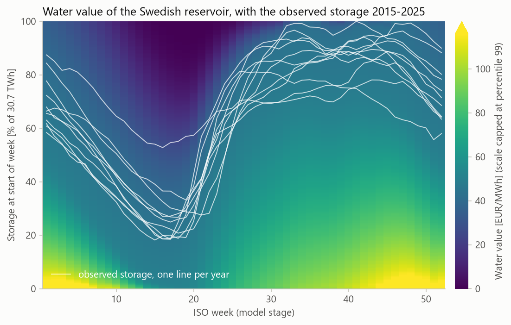
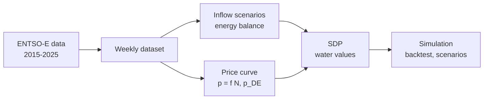
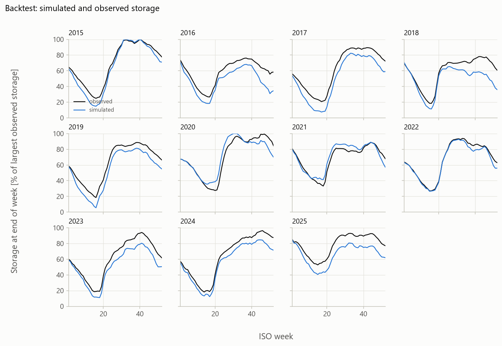
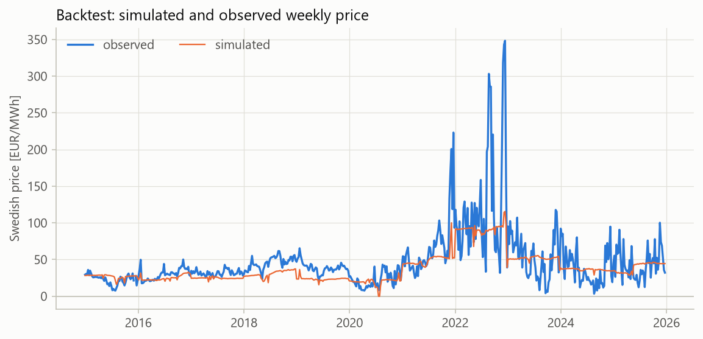
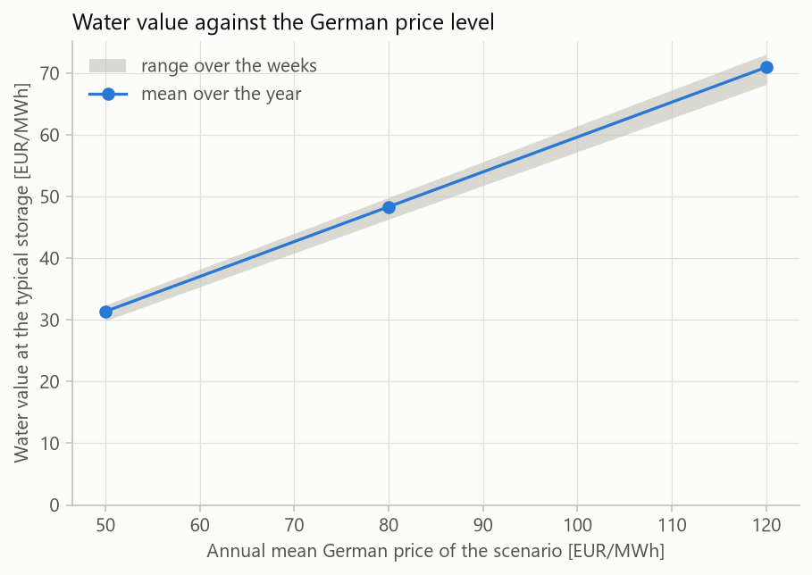
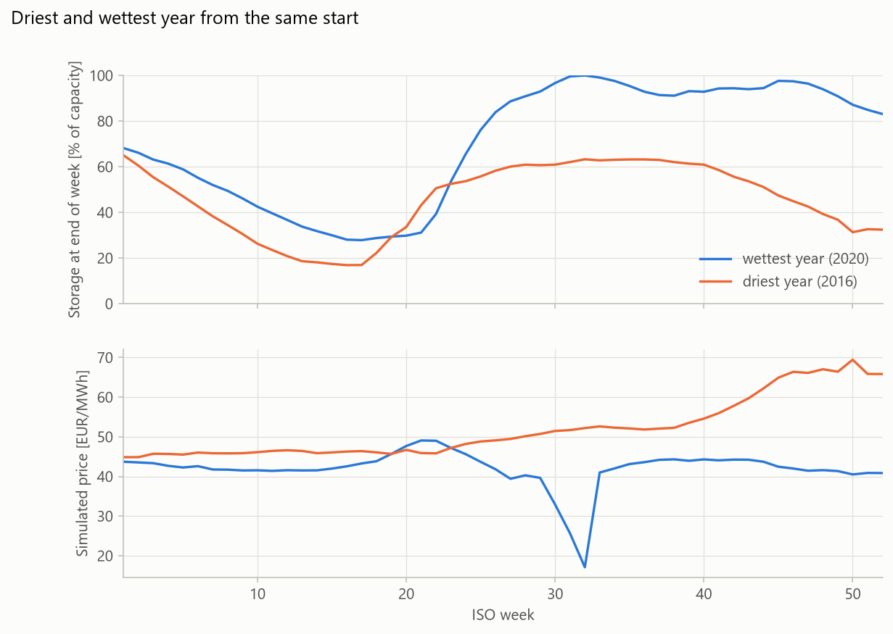
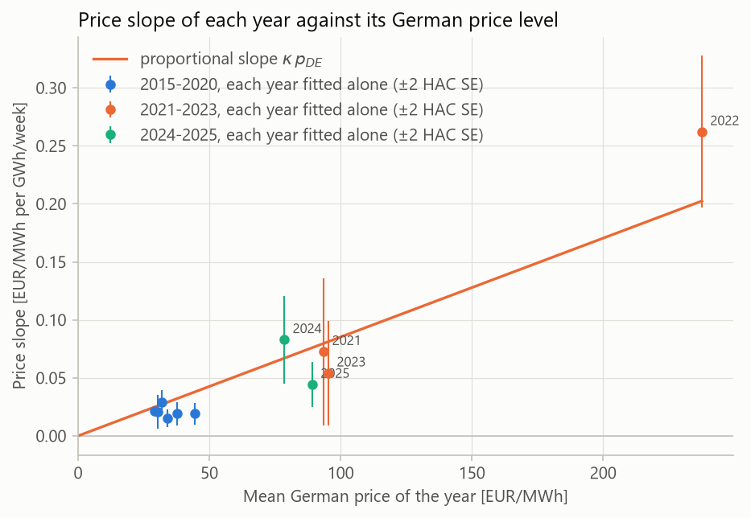

# nordic-hydro-watervalues

[](https://github.com/akamaxe/nordic-hydro-watervalues/actions/workflows/ci.yml)

[](LICENSE)

Water values for the aggregated Swedish hydro reservoir: a minimal, open EMPS-style stochastic dynamic programming model built on ENTSO-E data.

The water value is what one more MWh in the reservoir is worth: the future cost it saves by not being used today. In a hydro-dominated system like the Nordic one it sets the price. This repository rebuilds the core of an EMPS-type model at the scale of one aggregated Swedish reservoir. It reconstructs weekly inflows from public data, calibrates a price curve against German prices, solves the water values by stochastic dynamic programming and checks the result against how the reservoir was actually operated in 2015–2025.



## Key findings

<!-- key-findings:start -->
- Water is worth most when the reservoir is low before the winter: about 102 EUR/MWh in week 44 at 10% storage, against 2 EUR/MWh in week 16 with a 90% full reservoir just before the spring flood.
- The Swedish price follows the German price almost one for one at balanced trade (pass-through 1.01), and the discount that exports buy grows with the German price. At the average net import the Swedish price moves 0.66 EUR/MWh per EUR/MWh in Germany. Letting the price slope scale with the German price cuts the out-of-sample price error from 21.4 to 16.7 EUR/MWh.
- Each EUR/MWh on the continental price moves the Swedish water value by 0.57 EUR/MWh.
- Replaying 2015-2025 with water values that knew each year's demand and German price but not its inflow, the storage error is 9.7% of the largest storage observed (RMSE), and the weekly price correlates 0.71 with the observed one (0.96 for annual means, 0.40 within years). The model releases more water than producers did, so its prices run 9.0 EUR/MWh low on average.
- From the same start, the driest year (2016) ends with 10.0 TWh in storage against 25.5 TWh for the wettest (2020), at a mean price 10.0 EUR/MWh higher.
<!-- key-findings:end -->

## What the model does



1. **Data.** Weekly generation, load, prices and reservoir filling for Sweden come from the ENTSO-E Transparency Platform. The reservoir timestamp convention is verified against Energiföretagen's statistics.
2. **Inflow.** Weekly energy inflow follows from the reservoir's energy balance. Each year 2015–2025 becomes one inflow scenario.
3. **Price curve.** The Swedish weekly price is regressed on net import and the German price, with a slope proportional to the German price level. It is chosen among eight variants by out-of-sample error.
4. **Water values.** A weekly stochastic dynamic programme over storage and inflow scenarios, solved for a periodic year.
5. **Simulation.** Each historical year is replayed with a price curve and inflow scenarios that have not seen it. Two scenarios are run: the continental price level, and the driest against the wettest year.

## Results

<table>
  <tr>
    <td width="50%"><a href="notebooks/05_backtest_and_scenarios.ipynb"></a><br>Simulated and observed storage, each year with a price curve and inflow scenarios that have not seen it.</td>
    <td width="50%"><a href="notebooks/05_backtest_and_scenarios.ipynb"></a><br>Simulated and observed weekly price.</td>
  </tr>
  <tr>
    <td><a href="notebooks/05_backtest_and_scenarios.ipynb"></a><br>Water value against the continental price level.</td>
    <td><a href="notebooks/05_backtest_and_scenarios.ipynb"></a><br>The driest and the wettest year from the same start.</td>
  </tr>
  <tr>
    <td><a href="notebooks/03_price_model.ipynb"></a><br>Why the price slope scales with the German price.</td>
    <td></td>
  </tr>
</table>

## Validation

- **The reservoir data.** The timestamp convention of the reservoir series is checked against an Energiföretagen weekly report and against its weekly statistics for 2019–2025.
- **The solver.** It reproduces a brute-force dynamic programme. Its water values fall with storage and never drop below minus the spill penalty, and the optimality condition (price = discounted water value) holds at every interior decision.
- **The price model.** It is chosen by leave-one-year-out error, and each backtest year uses a price curve and inflow scenarios that exclude it.
- **The tests.** An offline test suite runs in CI on every push, including exact recovery on synthetic data and the mass balance of every simulated week.

## Reproduce

The weekly dataset is committed, so no API token is needed:

```bash
uv sync
uv run watervalues inflow && uv run watervalues price && uv run watervalues solve
uv run watervalues simulate && uv run watervalues figures && uv run watervalues findings
uv run pytest
```

`uv run watervalues fetch` and `uv run watervalues build` rebuild the dataset from ENTSO-E with a personal API token in `.env` (see [data/README.md](data/README.md)).

## Method

The full formulation is in [reports/methodology.md](reports/methodology.md). The notebooks tell the story in order:

1. [Data overview](notebooks/01_data_overview.ipynb)
2. [Inflow reconstruction](notebooks/02_inflow_reconstruction.ipynb)
3. [Price curve](notebooks/03_price_model.ipynb)
4. [Water values](notebooks/04_water_values.ipynb)
5. [Backtest and scenarios](notebooks/05_backtest_and_scenarios.ipynb)

## Limitations and next steps

- **One reservoir.** Sweden is modelled as a single aggregated reservoir and price area, without transmission limits between the hydro-rich north and the load in the south. A two-area version is the natural next step.
- **Independent inflows.** Inflows are independent between weeks, with eleven historical years. A PAR(1) inflow model would capture dry spells.
- **The price curve.** It is linear and reduced-form, and hydro's response to price makes net import endogenous.
- **Risk neutrality.** The model minimises expected cost. Together with independent inflows, this is a plausible reason why it releases more water than producers did.
- **Fixed demand and German price.** Residual demand and the German price are fixed inside the water value model, and the backtest knows both in advance.
- **Unobserved spill.** Spill is not observed, so wet-week inflows are underestimated.

## How this was built

Developed with Claude Code as an AI pair programmer. Modelling decisions, validation and review are my own; automated tests check every reported number.

## Data

Source: [ENTSO-E Transparency Platform](https://transparency.entsoe.eu). Energiföretagen's weekly statistics are used only for validation and are not redistributed. See [data/README.md](data/README.md) for provenance, processing rules and known gaps.

## License

MIT, see [LICENSE](LICENSE).
